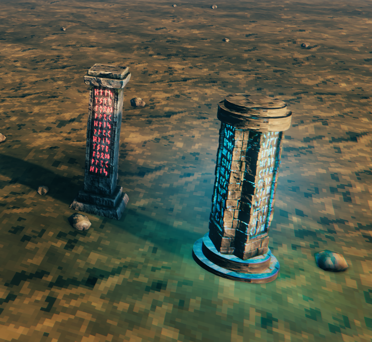
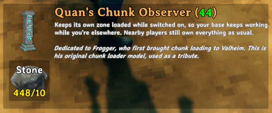
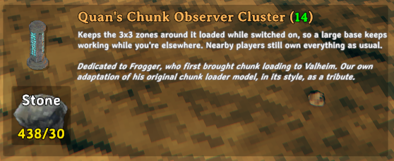
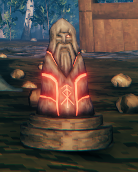
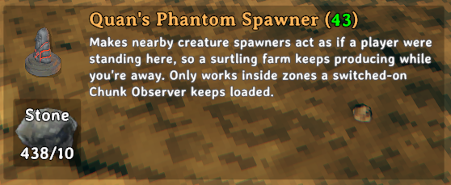

# Quan's Chunk Loader

## Chunkloading Done Right

Your smelters keep smelting. Your kilns keep burning. Your fermenters, beehives and crops keep working, and your
surtling farm keeps filling up with coal, all while you're on the other side of the map. Build a Chunk Observer,
switch it on, and the server keeps that part of the world running.

Almost every chunk loader gets the fundamentals wrong. They promise things the game simply won't allow, and bring
more bugs than features: auto-fuel that stops, plants that never regrow, boats on the seabed, tames that ignore you.
**This one is a ground-up rewrite that does it differently.** It loads your base and nothing else, so everything
works the way the game intended, whether you're there or not.

- **Keep production going** with nobody nearby, in a single zone or a whole 3 × 3 block of them.
- **Let your tames keep breeding and growing** while you're away, if you want them to.
- **Keep it going after the last player logs off**, for up to an hour by default.
- **Run surtling farms with nobody home**, and come back to every drop still waiting for you.
- **Walk back in and everything just works:** your auto-fuel, auto-store, plant timers and creature commands.
- **No monsters wandering your empty base**, no boats sinking at the edge, no buildings collapsing.
- **Admin tools to keep it fair:** zone limits, admin-only building and a map of every loader.

**Install it on the server and on every client.** Players without it can't connect. It needs
[Jotunn](https://thunderstore.io/c/valheim/p/ValheimModding/Jotunn/), which installs alongside it. Coming from
another chunk loader? See [Moving from an older chunk loader](#moving-from-an-older-chunk-loader) first.

<b>Why most chunk loaders cause problems, and what's actually possible in Valheim</b> (click to read)

### What it fixes

If you've run a chunk loader before, these may look familiar. They all come from the same root cause, explained
below.

| What you see | Why it happened |
|---|---|
| Auto-fuel and auto-store stop working in a loaded base, even while you're standing in it. | The server kept ownership of everything in loaded zones, and those mods only act on objects your game owns. |
| Plants say "Ready" but never regrow. | The player who picked them walked away but kept ownership, and only the owner's game regrows a plant. |
| A boat moored at the edge of a loaded area is found sitting on the seabed. | Part of the boat was over a zone that wasn't loaded, which reads as "no water", so the boat stopped floating. |
| Picking crops or berries sometimes does nothing. | The server owned them, and the game's picking code expects the owner to be a player. |
| Surtling farms stop spawning when nobody is near. | Spawners only spawn with a player nearby. |
| Opening the large map stalls, and portal selection on the map stops responding. | The loader rebuilt every map pin every few seconds. |
| Tames in a loaded base ignore E, or all jump somewhere else at once. | Whoever switched the loader on kept running the whole base from wherever they went. Commands went to their game, and their mods acted on tames they weren't near. |

### How chunk loading works, and why it goes wrong

This is how the game works, not a criticism of anyone's mod. Chunk loading is harder than it looks.

- **"Loaded" isn't the same as "owned by a player".** In Valheim, each object is run by one game at a time: its
  owner. The game decides two separate things: which parts of the world are loaded, and whose game runs each
  object. A chunk loader only needs to change the first.
- **The common shortcut changes both.** Most loaders tell the game that every point in a loaded zone is "near"
  everyone: the server and every player, wherever they are. That keeps the zone loaded, but it also tells the game
  that whoever owns an object is still near it. So the server never hands objects to the player standing next to
  them, and a player who walks away keeps everything they touched. Their game keeps running that base from the
  other side of the map, along with all their client-side mods.
- **Some of the game's own code assumes the owner is a player.** Picking, sail changes and some cooking stations
  look up "the local player", and a dedicated server doesn't have one, so those actions fail when the server owns
  the object.
- **A boat needs water under all of it.** A boat reads the water at five points. A point over a zone that isn't
  loaded reads as "no water", and one bad reading in five is enough to switch its floating off.

**This mod only changes which zones the server keeps loaded.** It never changes who counts as "near", so ownership
works exactly as it does in the base game.

### What no chunk loader can do

- **Nothing runs all night.** The world clock only moves while someone is online, and every smelter, kiln, crop and
  fermenter measures progress against that clock. With nobody online, time stands still everywhere. This mod keeps
  the clock going for up to an hour after the last logout by default (servers can allow up to four); beyond that,
  nothing can progress.
- **Nothing refuels or empties itself.** Auto-fuel and auto-store mods run on players' computers and need a player
  nearby. With nobody near, a smelter only gets through what's already in it, which is why bigger stations get far
  more out of a loader (see [Pairs well with](#pairs-well-with)).

## Chunk loaders

<table>
<tr>
<td></td>
<td></td>
</tr>
</table>

The world is divided into zones 64 m square. Pick the loader that fits your base, switch it on, and the server keeps
its zones running with nobody nearby.

| Piece | Cost | Keeps loaded |
|---|---|---|
| **Chunk Observer** | 10 Stone | Its own zone (64 × 64 m) |
| **Chunk Observer Cluster** | 30 Stone | Its own zone and the eight around it (192 × 192 m) |

Both are in the **QuanPieces** tab of the hammer and need no crafting station.

- **Switch it on with E.** The runes turn from red to glowing blue, at once for everyone nearby. No fuel: it stays on
  until someone switches it off.
- **See exactly what it covers.** Look at it and tap your alternative-placement key (Left Shift by default; the hover
  text shows yours). Thin white lines mark the zone borders, with a post at every corner.
- **Only its builder or an admin can switch it,** so nobody turns off your base. The hover text shows who built it.
- **It can't be damaged, monsters ignore it**, and it doesn't count as a base, so it changes nothing else around it.
  Remove it with the hammer as usual.
- **Overlap freely.** Two loaders covering the same zone cost nothing extra, so add a single one at your dock if it's
  just outside a cluster's area.
- **Fair limits:** by default each player's switched-on loaders can cover 18 zones (two clusters, or any mix) and
  the whole server 108. Admins' loaders don't count.

## Farms that keep farming: the Phantom Spawner

<table>
<tr>
<td></td>
<td></td>
</tr>
</table>

Creature spawners only spawn when a player is near, so a surtling farm normally stops the moment you leave. Place a
Phantom Spawner beside it, inside a loaded zone, and the spawners around it act as if you'd never left. Build the
farm over water and the coal piles up while you're away.

| Cost | Crafting station | Range |
|---|---|---|
| 10 Stone | None | The range each nearby spawner already uses (60 m for surtling spawners) |

- **Active wherever a switched-on loader keeps the zone loaded.** Its hover text says "Active", or "Dormant: no
  active chunk observer" anywhere else.
- **Your loot waits for you.** Drops near an active phantom don't despawn, so it's all still there when you come
  back.
- **Surtlings only, unless you choose otherwise.** No other monsters run in a loaded base with nobody there. Admins
  can add other spawners, and nests and bone piles, in the config, knowing those monsters can then attack the base.
- **It isn't a ward**: it doesn't protect anything or control access. No fuel, no map pin, and it can't be damaged.

> **Spawner names, ready to copy.** Each time the game starts, the mod writes
> **`BepInEx/config/quandru.QuanChunkLoader.spawners.txt`**, next to its config file. It lists every creature
> spawner in your game, with what each one spawns, how often and from how far away, and marks the ones you already
> use. It reads them from the game itself, so **spawners added by other mods are included too**, and the list keeps
> up as you add mods. Copy names from it into "Creature spawners", separated by commas.

## What else it does

- **Lets your tames keep breeding and growing while you're away**, if you choose. Turn on "Simulate tames in
  loaded zones" and the server runs the tamed animals in a loaded base while nobody is near, just as if a
  player were standing there:
  - **They carry on as normal:** eating from their troughs, breeding, having young, healing and wandering their pens.
  - **Their young grow up** on time.
  - **It keeps going while anyone is online**, and through the time after the last logout; after that the world clock
    stops for everything.
  - **Taming new animals doesn't continue:** wild creatures in a loaded base stay paused until someone comes back.
  - **Keep an eye on pen sizes.** With nobody watching, a pen can breed well past the numbers you'd normally see, and
    any tame mod's feeding and breeding code runs on the server.

  It's off by default. Then tames simply pause while nobody is near, as they would without a chunk loader, and carry
  on when a player arrives; young ones still grow up on time, because growing up catches up.
- **The nearest player always runs things.** Walk into a loaded base and your game takes over everything around you
  within about 2 seconds, exactly as without a chunk loader, so auto-fuel, auto-store, plant timers and creature
  commands all work. Leave, and the server takes over. Nobody runs a base from the other side of the map, and
  switching a loader on gives you nothing but loaded zones.
- **Production after the last logout.** Normally the world clock stops when the last player leaves. With a loader
  on, it keeps running in real time for up to an hour (servers can set up to four), so loaded smelters, kilns,
  fermenters, beehives, crops and regrowing plants finish their work. Logging in and out can't stretch it.
- **Your output doesn't despawn.** Items on the ground normally vanish after an hour unless a player is close. In
  loaded zones, drops near a production station or an active phantom are kept until someone collects them.
- **Boats stay afloat** at the edge of a loaded area, instead of sinking because part of them is over unloaded
  water. A boat pulled up on a beach still sits on the sand.
- **Buildings at the edge stay up.** Pieces at the outer edge of a loaded area don't weather or re-check their
  support while nobody is near, so nothing collapses because its neighbour wasn't loaded.
- **Your base stays quiet.** Wild creatures in a loaded base wait where they were until someone comes back, and nests
  and spawners there don't run, so nothing wanders through or attacks an empty base.
- **Nothing gets deleted by a missing mod.** If the server doesn't have a mod that something in a base came from,
  the game would delete it the moment the server loads it. This mod leaves those objects alone and names them in the
  log.
- **Admin tools.** A map of every loader (lit when it's on), "Admin-placed" on hover, admin-only building for a
  trial run, limits by zones, and an optional expiry for loaders nobody has switched on in a while.
- **The awkward moments fixed.** Picking a crop or changing a ship's sail where the server is running things no
  longer fails or throws errors.
- **Logs worth reading.** Every switch, every change to the loaded zones and a 5-minute summary of who owns what,
  with warnings if something looks wrong. A few lines a minute at most.

Everything is adjustable in the mod's config, and the server's settings apply to everyone.

## Pairs well with

- **Bigger or faster production stations.** With nobody there, a station only gets through what it's already
  holding. One that holds 10 ore at 30 seconds a bar runs dry after 5 minutes, so more capacity means far more
  production while you're away.
- **Auto-fuel mods.** They refill stations while you're in the base, and work in loaded bases again.
- **Auto-store mods.** They collect output into nearby chests while you're in the base, and work again too.

## Moving from an older chunk loader

This mod replaces Frogger's ChunkLoader, ChunkLoader Continued and ChunkLoaderFix, and won't run alongside any of
them: if one is installed it stays switched off and says so in the log.

1. **Before the swap**, remove your old chunk loaders with the hammer. Once the old mod is gone its pieces can't
   load, and whatever they cost is lost.
2. **Swap the mods on the server and every client at the same time.**
3. Build new Chunk Observers (or clusters) where you want them.

## Known limits

- **Production after the last logout** lasts an hour by default (up to four if the server sets it), and only while a
  loader is on. Dedicated servers only: a local game ends when its host leaves.
- **Windmills vary offline.** With nobody online, the server works out the wind at one fixed spot rather than at
  each windmill, so offline output can be higher or lower than you'd see in person.
- **Seed Totems** only plant while a player is near, like auto-fuel.
- **Clients don't load anything extra.** The server keeps loaded bases running; your own game only loads what's
  around you, as normal.

## Credits and licence

> **Dedicated to Frogger**, who first brought chunk loading to Valheim. As a tribute, the Chunk Observer uses
> Frogger's original chunk loader model, and the Cluster is our own adaptation of it in his style. Their build cards
> say so. The model is the only thing reused: no code comes from Frogger's mod or any other chunk loader.

Frogger's model comes from [JFHeim/ChunkLoader](https://github.com/JFHeim/ChunkLoader), under the MIT licence
(Copyright (c) 2023 Vyacheslav). The full notice is in `THIRD-PARTY-NOTICES.md` in this package. Thank you, Frogger.

Bugs and suggestions: the Issues page of this mod's GitHub repository (linked from this page).
