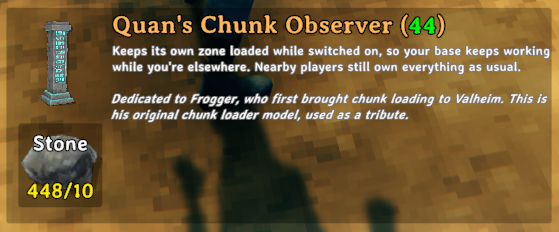

# Quan's Chunk Loader: design

Status: design agreed on 2026-10-25. Core built on 2026-11-04; the rest of 1.0 built on 2026-11-05. **Everything passed
its single-player check on 2026-11-06, and 1.0.0 was released and uploaded to Thunderstore the same day.** Next: the live rollout. See
[Build status](#build-status).
Valheim 1.0.21 (network version 41), BepInEx, Jotunn.

Quan's Chunk Loader (`QuanChunkLoader`) is a new chunk loader for dedicated servers. It replaces Frogger's original ChunkLoader and two later forks of it, NerdLounge "ChunkLoader Continued" and zeeCamelSnake "ChunkLoaderFix". It's a rewrite rather than a fork. The old mods share one core mechanism, and that mechanism causes their main bugs (see [Why the old approach fails](#why-the-old-approach-fails)).

Every claim below was checked against the 1.0.20 decompile, re-checked against 1.0.21 on 2026-11-01, and, where possible, against logs from a read-only diagnostic plugin. The diagnostic ran for two weeks on a live 5-player, 69-mod server (see `diagnostic-test-plan.md`).

## Build status

Updated 6 Nov 2026. **Everything planned for 1.0 is built and passed its single-player check** (the core on 5 Nov,
the rest on 6 Nov). What only a dedicated server can show is checked during the rollout.

**Pieces: three**, all in the QuanPieces hammer tab, none needing a crafting station:

| Piece | Prefab | Loads | Cost |
|---|---|---|---|
| Chunk Observer | `Quan_ChunkObserver` | 1 zone: its own (64 × 64 m) | 10 Stone |
| Chunk Observer Cluster | `Quan_ChunkObserverCluster` | 9 zones: its own and the 8 around it (192 × 192 m) | 30 Stone |
| Phantom Spawner | `Quan_PhantomSpawner` | Nothing; runs nearby spawners inside loaded zones | 10 Stone |

The two observers replace the "Area size" setting (Quandru, 5 Nov 2026): players choose per observer by what they
build. Costs are fixed; the "Stone cost" setting is gone (Quandru: a slider for it is pointless).

**Core: passed its single-player check on 5 Nov 2026** (local world, "Chunkloader test" Gale profile, 71 mods,
Log detail Trace), on the single observer when it still loaded 3×3:
- Built, switched, hit (no damage) and removed as designed; red runes off, blue on, the hammer's remove highlight
  clears back to the right colour.
- **Stayed loaded with the player away:** three 5-minute summaries (22:29–22:39) with the player far off showed
  9 zones, 1,178 of 1,188 objects running, 3 tames and 7 wild creatures paused with no owner. Passes took 0.4 ms.
- **Survived a reload:** "Found 1 chunk observer(s) in the world, 1 switched on" and the 9 zones loaded again.
- No errors from the mod.
- **Found:** passes that write ~1,000 Trace lines took up to about 1 s (loading the world, flying away, coming
  back), because every line was written and flushed one at a time. The daily file now flushes once a second;
  BepInEx's own log still writes each line. Info, the default, logs none of those lines. Don't leave Debug or Trace
  on for the live server.
- **Local game only:** the host and the server share one owner ID, so while the host passes the edge of their own
  area vanilla `ReleaseNearbyZDOS` drops objects to no owner and our pass claims them back, two or three times each.
  On a dedicated server the server's ID differs, so this can't happen.

| Part | What it means | Status |
|---|---|---|
| Chunk Observer and Cluster | Frogger's model at 50%: one column, or three on round plinths. Dedication on both build cards. Can't be damaged; the hammer removes them. | Checked (look, dedications, no damage, removal) |
| Switching | E switches it on or off. Only its builder or an admin can, by default; the hover shows the size, who built it, and "Admin-placed" to admins. | Checked |
| Server loading | The server keeps every zone of every active observer generated and its objects running. No wild creatures (except phantom spawns), no tames unless "Simulate tames" is on. Clients load nothing extra. | Checked |
| Ownership rule | Every 2 s the server takes objects in loaded zones that no player is near; vanilla hands them to nearby players. Objects owned by a far player are taken back; paused creatures held from afar are released. | Checked in single player; needs the dedi |
| Edge-support rule | Wear and support (and `StaticPhysics`, ordinary `SpawnArea`s) only run where all 8 neighbouring zones are loaded; phantom-run spawner areas anywhere in a loaded zone. | Built |
| Unknown-prefab guard | Objects whose prefab the server doesn't know are skipped and logged, not deleted. | Built |
| Logging | Switches, zone changes, 5-minute summaries, warnings, distant claims, unknown prefabs, phantoms, the empty-server clock. | Checked |
| Phantom Spawner | Allowlisted creature spawners (default surtlings; spawner areas only if admins turn them on) act as if a player stood at an active phantom. Without a phantom, spawners the server runs in loaded zones don't run at all. | Checked (a surtling farm kept producing while away) |
| Boat fix | Water readings from unloaded zones are replaced with the ship's centre reading while it runs on the server. | Built; rollout check |
| Despawn protection | Items in loaded zones within 8 m of a station or 40 m of an active phantom don't time out, on the server and (since 6 Nov) on players' games. | Checked on the server side (surtling loot kept); players' games: rollout check |
| Empty-server hour | With an observer on, the world clock keeps running in real time for up to 60 min after the last logout (admins can set 0–240). | Built 5 Nov; dedicated server only |
| Limits and admin-only building | Zones per player (18) and in total (108), each zone counted once from 1.1.0, admin exemption, expiry, admin-only building. | Per-player limit checked; the rest built |
| Map | Admins can show every observer on the map (personal setting), as icons only; nobody else receives them. | Checked |
| Zone grid | Looking at an observer and tapping AltPlace (or AltPlace + Use) draws the zones it loads for 2 minutes (15 s in 1.0.0). | Checked (1x1 and 3x3) |
| Spawner reference list | `BepInEx/config/quandru.QuanChunkLoader.spawners.txt`: every creature spawner in the game, for the phantom's list. | Checked |
| Defensive patches | `Pickable.RPC_Pick` and `Ship.UpdateSailSize` no longer fail when the server owns the object. | Built 5 Nov; needs the dedi |
| Release | Thunderstore page reworked into a pitch with a collapsible block (see [README outline](#readme-outline)), changelog dated, **1.0.0 built, tagged `v1.0.0` and pushed on 6 Nov 2026.** The package depends on BepInExPack 5.4.2360 and Jotunn 2.30.2: check the server's shared profile has them or later. Quandru uploaded it to Thunderstore the same day. | Done |

**Single-player check of the full build: passed on 6 Nov 2026**, every step including a surtling farm run by a
phantom while away (screenshots in `docs/images`). Found while answering a question afterwards: despawn protection
only ran on the server, so a player arriving more than 25 m from an hour-old pile would have lost it; now fixed on
players' games too (a rollout check, since single player can't show it).

**Live since 7 Nov 2026 (1.1.0).** Where the live test stands, and what's next: [Live test, 7 Nov
2026](#live-test-7-nov-2026-110).

**Was next (6 Nov):** the **live rollout** (1.0.0 is on Thunderstore since 6 Nov 2026) per [Test plan for the real mod](#test-plan-for-the-real-mod): back up the world, swap the old
   loader out on the server and every client at once, start cautious ("Only admins can build" on, empty-server
   window 0), and turn on "Simulate tames in loaded zones" for Quanheim (decided 2 Nov).

Several parts only show on a dedicated server (ownership between players, the empty-server hour, the defensive
patches, despawn protection on players' games); those are checked during the rollout.

## Goals

1. **Keep a base's production running** while its owner is elsewhere in the world, without breaking anything when they come back.
2. **Ownership always goes back to a player** who is near an object. The server holds an object only while no player is near it.
3. **Boats stay afloat** in loaded areas.
4. **Surtling farms keep spawning** without a player present.
5. **Up to one real hour of offline production** after the last player logs off (by default; admins can set up to
   four hours, Quandru 6 Nov 2026).
6. **Low overhead** and clean coexistence with large modpacks.
7. **No player's game ever runs a loaded base it isn't near.** Only the server keeps a base running while nobody is there, so a player's client-side mods can never act on a base they've left.

Out of scope for v1:
- Changing conversion capacity or speed. Leave that to other mods.
- A server-side collector that refuels smelters and empties output while nobody is near. It's a possible later feature.

## Why the old approach fails

All three old mods postfix `ZNetScene.InActiveArea` to return `true` for any point in a loaded ("forced") zone, whatever reference point is being asked about. That single answer feeds several unrelated systems.

- **The server hoards ownership.** `ZDOMan.ReleaseNearbyZDOS` runs every 2 s for the server and for each player. A player takes an object only if its current owner is out of range, and the patched check always says the server is in range. So objects in a loaded zone stay with the server even while a player stands next to them. The only exception is a chest a player opens, which moves explicitly. Logs: across a week there were 57 handovers to players, every one of them an opened chest or a touched tame, and none happened through proximity. Separately, 1,873 objects went to the server across 31 logouts.
- **Players who leave keep ownership.** The same check tells the game that every loaded object is in range of every player. A player who visits a base and walks away keeps its objects until they log out. One logout moved 271 objects at five different bases to the server. zeeCamelSnake also patches `IsInPeerActiveArea`, which makes this worse.
- **Whoever switches a loader on takes the whole base.** The player standing there when it's switched on owns everything in its zones from then on, even if it isn't their base. On 1 Nov 2026 one player switched on the loader at another player's farm. The diagnostic showed all of its roughly 130 tames, plus its containers and stations, owned by that player for the next 75 minutes while they explored 4–5 km away.
- **Distant players run the base on their own machine.** The patched check also runs on clients, so a player keeps the loaded base's objects instantiated and simulated on their PC wherever they are. Their client-side mods then act on a base they aren't near. On 1 Nov, when that player died far away, a tame mod on their PC moved about 200 tames from two loaded bases to the death spot in one second. See the QuanCompanions feature list (`QuanCompanions/docs/feature-list.md`) for the tame mod's side of this.
- **Commands to a base's creatures get lost.** Vanilla sends a creature command (E to follow or stay) to the PC that owns the creature, and only that PC can change it. When the owner is a player far away, their PC can't find the requesting player, so the command is quietly ignored. On 1 Nov, players in the farm couldn't reliably make their own tames stay.
- **Mods that need a player owner stop.** AzuAutoStore and OttoFuel only act on objects the local player owns, so with the server as owner they never run. Smelting chains stall even with a player in the base.
- **Vanilla code that assumes the owner has a player** throws errors when the server is the owner:
  - `Pickable.RPC_Pick` calls `Player.m_localPlayer.GetZDOID()`, so picking fails silently. One harvest logged about 120 of these errors.
  - `Ship.UpdateSailSize` fails the same way. The exception escapes `MonoUpdatersExtra.CustomFixedUpdate` and aborts the rest of that physics tick for fish, AI, characters and area effects. 1.0.21 narrowed this: the local-player lookup now runs only while someone is at the ship's controls. It still runs on every machine that has the ship loaded, including the server, so a player changing sail inside a loaded zone still throws on the server.
- **Plants never regrow.** Only the owner's copy of a pickable runs its regrow check (`Pickable.UpdateRespawn`, every 60 s). If the owner is a player who has left, nobody runs it. PlantEverything's hover then shows "Ready" while the plant stays bare, until someone switches the loader off and reloads the area.
- **Boats sink at the edge of a loaded area.** `Ship.CustomFixedUpdate` averages five water samples: centre, bow, stern, left and right. A sample in a zone the server hasn't loaded returns -10000, so the average collapses and buoyancy switches off entirely. A server-owned boat moored at the edge of a loaded area then rests on the seabed. The diagnostic confirmed this in about 40,000 observations with no counter-examples. Every sinking had a sample in an unloaded zone, and every boat with all five samples loaded floated.
- **The map lags.** The old mods remove and re-add every loader pin every 4 s and scan all ZDOs on the client. Opening the large map stalls for a second or two, which also blocks TargetPortal's portal selection.

Two more facts limit what any chunk loader can do:

- **The world clock stops on an empty server.** `ZNet.UpdateNetTime` only advances world time while at least one player is connected. Smelters, kilns, fermenters, beehives, crops and plant regrowth all measure progress against that clock, so nothing progresses with nobody online. The server program itself keeps running, and loaded zones stay loaded.
- **Auto-fuel and auto-store mods run on players' machines.** They need a local player, and a dedicated server has none. So with no player near a base, nothing refuels a smelter or collects its output.

## Pieces

**Observer model (decided 2026-10-25):** Frogger's original `ChunkLoader_stone` model, as a tribute. It comes from the `chunkloader` asset bundle in [JFHeim/ChunkLoader](https://github.com/JFHeim/ChunkLoader) (`src/assets/chunkloader`, MIT).
- **Scale: 50% of the original size (Quandru, 5 Nov 2026),** about 1.25 m tall, chest height. The column mesh is
  2.47 m tall at full size; Frogger's mod never rescales it, so old loaders on the server are 2.47 m. The design
  first said 75% (about 1.85 m, player height); Quandru saw that in game next to the old mod and chose 50%.
- **Rune colour (Quandru, 5 Nov 2026):** red runes while off, blue and glowing while on, as Frogger's original. His
  mod set `_EmissionColor` to `Color.red * 6` when off and back to the material's own (2, 2, 2) when on; ours does
  the same on each observer's own material copy. The light comes on only while on. The bundle's `sparcs` particles
  don't visibly show; Quandru doesn't need them.
- Ship the bundle as an embedded resource. **Found when building (4 Nov 2026):** the bundle's `ChunkLoader_stone` prefab carries only vanilla scripts (`ZNetView`, `Piece`, `WearNTear`, `LightLod`); the old mod adds its `ChunkLoaderMono` in code. So both observers are clones of that prefab, renamed and set up by our code, with no missing-script warnings. Built with Unity 6000.0.72; the game runs 6000.0.75.
- **Dedication on the build card (Quandru, 4 Nov 2026):** the single observer's description ends with a short line dedicating the model to Frogger: "Dedicated to Frogger, who first brought chunk loading to Valheim. This is his original chunk loader model, used as a tribute." The cluster isn't his model as he made it, so its card says (Quandru, 6 Nov 2026): "Dedicated to Frogger, who first brought chunk loading to Valheim. Our own adaptation of his original chunk loader model, in its style, as a tribute." The single observer's card in game, 6 Nov 2026 ([docs/images/observer-card.png](images/observer-card.png); the cluster's is `cluster-card.png`, the phantom's `phantom-card.png`, and in-game pictures `observers.png` and `phantom.png`, all on the Thunderstore page):

  
- MIT requires the copyright and licence notice in copies, so `THIRD-PARTY-NOTICES.md` is in the repo root and in `Package/` (which ships in the Thunderstore zip).
- The bundle can't be loaded twice, so it would clash with the old mod if both were installed. The incompatibility check already prevents that.

All three pieces go in the **QuanPieces** hammer tab and need no crafting station. Costs are fixed (no setting). None
carries a PlayerBase `EffectArea`, so none suppresses spawners or counts as a base.

### Quan's Chunk Observer (`Quan_ChunkObserver`) and Chunk Observer Cluster (`Quan_ChunkObserverCluster`)

**Two pieces instead of an "Area size" setting (Quandru, 5 Nov 2026).** Players choose per observer by what they
build:
- **Chunk Observer:** the single column. Loads its own zone (1×1, 64 × 64 m). 10 Stone.
- **Chunk Observer Cluster:** three columns. Loads its own zone and the 8 around it (3×3, 192 × 192 m). 30 Stone.
  - **Look (Quandru, 6 Nov 2026):** three of the columns, 120 degrees apart, each with a flat (rune) face pointing
    straight out, overlapping tightly around the middle (Quandru's sketch: the three squares share a triangle in the
    centre), on a shared round two-step base under a shared round capital whose lips only just extend beyond the
    corners. (The first builds had a corner of each pointing out, then a pinwheel of columns just touching; both
    misread the request.)
  - **How it's built** (`ClusterModel`): the column mesh is readable, so the shaft alone is cut out of it at load
    (triangles between 0.30 and 2.20 m of the 2.47 m column; the base and capital are dropped). Each shaft stands
    0.08 model units (before the 50% scale; about 15% of its width) out from the centre towards its outer rune face,
    at exactly 0, 120 and 240 degrees, so the outer faces extended form an equilateral triangle with the centres of
    the rune faces at its side midpoints (Quandru, 6 Nov 2026; the shaft and its rune panels are centred on the mesh
    to within 0.005, under 3 mm in game);
    the shafts pass through each other in the middle, where nobody sees. Their outer corners reach 0.42; the lips
    above and below are 0.44, the lower base step 0.56. The round steps and capital are cylinders generated in code,
    textured with the plain stone patch of the column's own texture (the capital's top face), so they match. Each
    column's second rune face is inside the cluster.
  - **Icon:** rendered from the model with Jotunn's `RenderManager` (skipped on a dedicated server, which has no
    graphics); the single column's icon is the fallback.

Both observers:
- **No fuel.** It runs until switched off from its hover menu.
- **Only its builder or an admin can switch it** (server setting, on by default). Other players see who built it and can't change it. With the setting off, switching falls back to wards (`PrivateArea.CheckAccess`).
- **Its glow updates immediately for everyone nearby** when switched. The old mod took 2-3 s.
- **Show its zones (Quandru, 6 Nov 2026):** looking at an observer and tapping the AltPlace key, or holding it and
  pressing Use (as Frogger's mod did), draws the zones it loads for 2 minutes (15 s in 1.0.0; lengthened by Quandru on 7 Nov): thin white lines along the zone borders,
  following the ground, and thin white posts at every zone corner (QuanTerraforming's zone grid, in white). Drawn on
  the player's own machine from the observer's position and size, so it works for anyone, on or off. Frogger's
  mod tinted the terrain dark blue instead.
  - **Other loaded zones nearby in yellow (Quandru, 7 Nov 2026; 1.1.0).** The player's game asks the server which
    zones are loaded within 4 zones of the observer's own, and draws those that aren't part of its block in yellow;
    where a yellow line would lie on the white grid, white wins. The server answers with zone squares only, never who
    built what or where an observer stands, so it stays in line with the admin-only map. Asking the server rather than
    using observers the player's game has loaded catches neighbours more than about 2 zones from the player.
- **Hover text** shows on/off, the size it loads, and the builder's name. **Admins only** also see "Admin-placed" on observers an admin built. Other players never see it. The flag is stored on the observer (it has to survive restarts); it isn't secret data, just not displayed to non-admins.
- **It can't be destroyed and monsters ignore it.** It isn't a target for AI (`StaticTarget`, `Piece.m_targetNonPlayerBuilt`), and a prefix on `WearNTear.RPC_Damage` blocks damage. Removing it with the hammer still works.
- **Overlap is allowed.** Loaded zones form a set, so overlapping observers cost nothing extra. That lets a player add a single observer at a dock on the edge of a cluster's area.
- **Edge rule and the two sizes:** wear and support only run where all 8 neighbours are loaded, so a cluster's
  centre zone gets full vanilla wear and a single observer's zone never does. That's safe (edge pieces just don't
  weather). **Spawner areas a phantom runs are the exception (Quandru, 6 Nov 2026):** they work anywhere in a loaded
  zone, so phantoms work with a single observer and across a whole cluster, not only in its centre zone.

### Quan's Phantom Spawner (`Quan_PhantomSpawner`)

- **Look (Quandru, 6 Nov 2026):** the vanilla ward (`guard_stone`) model scaled to 25%, in grey stone like the observers, with only its rune lines glowing red. The ward is a carved wooden Odin statue: its materials (`Guardstone_Oden_mat`, `Guardstone_OdenGlow_mat`; read from the game's bundle on 6 Nov) share the wood texture `OdenStatue_d`, and the rune lines are on the glow material's emission map `OdenStatue_e`, which `PrivateArea` lights with `_EMISSION`. At load the mod makes a stone-grey copy of the wood texture (brightness kept, tinted to the observers' stone, alpha kept; through a render texture, since game textures aren't readable; skipped on a dedicated server) and puts it on copies of the materials, so the carving and UV layout are unchanged; the glow material gets a red `_EmissionColor`. A material without an emission map gets no glow. (Earlier builds tinted everything red, then tar-black.) It stands on a small round two-step stone plinth (0.20 m and 0.16 m radius, 0.11 m tall), the shape of the top of the cluster's capital and in the same stone (Quandru, 6 Nov 2026). Its hammer icon is rendered from the model (the ward's own icon is gold). Built from the ward's look only: its particle effects, lights, sounds, trigger volumes and every script other than `ZNetView`, `Piece` and `WearNTear` are removed (`PrivateArea`, its area marker and any `EffectArea` among them), and loading stops with an error if a `PrivateArea` or `EffectArea` were still there. What was removed is logged at Debug.
- **Makes nearby spawners behave as if a player were standing there.** Surtling spawners are `CreatureSpawner`s (`Spawner_imp_respawn`: 60 m trigger, 5-minute respawn on world time). Support is limited to a config allowlist, default `Spawner_imp_respawn`. **Spawner reference list (Quandru, 6 Nov 2026):** each time the game starts, the mod writes `BepInEx/config/quandru.QuanChunkLoader.spawners.txt` listing every `CreatureSpawner` prefab in the game (other mods' too) with what it spawns, its respawn time and trigger range, marking those already in the list. The setting's description points to it. Spawner areas aren't in the file (they can't be chosen by name); the "Spawner areas" setting's own description says what it covers. It's a separate file because BepInEx rewrites the .cfg and keeps only settings and their descriptions. `SpawnArea` support (nests, bone piles) is a separate setting, **off by default** (Quandru, 6 Nov 2026: no monster AI in loaded zones except surtlings unless admins choose otherwise).
- **Active only inside a zone that an active observer keeps loaded,** and only if it wasn't built while only admins could build. Outside one, its hover text says "Dormant: no active chunk observer" so players know why. The server decides this, because non-admins don't receive the observer list. **As built (5 Nov 2026):** the server writes "active" onto the phantom whenever the loaded zones change, instead of answering a hover RPC; every player's hover reads it with no extra traffic.
- **No fuel or timer, no map pin, can't be destroyed** (same as the observers). There's no per-zone limit.
- **Not built: the placement ring.** The design wanted the workbench's dotted ring while placing; the ward's own area marker is removed with the rest of the ward. A possible later addition.
- **How it works:**
  - A prefix and finalizer on the spawner update (`CreatureSpawner.UpdateSpawner`, `SpawnArea.UpdateSpawn`) sets a scoped "phantom context" flag on the server, for allowed spawners only. While it's set, a postfix on `Player.IsPlayerInRange` treats an active phantom as a player at its own position, within the caller's own `range`. That covers both the plain and the noise overloads.
  - Nothing global changes and no transpilers are involved. `IsPlayerInRange` contains a `foreach`, so it won't be inlined.
  - **Phantom spawns run as normal:** a creature made while the phantom passed the check is marked on its ZDO (`QCL_phantom`, from a postfix on `Character.Awake` inside the context). Marked wild creatures load and run on the server in loaded zones; other wild creatures stay paused.
- **Respawning follows world time,** because the `CreatureSpawner` respawn delay uses it. A farm spawns while anyone is online and during the empty-server hour, and stops after that.
- **Farm behaviour:** surtlings that spawn into water die at once, so the spawner's caps never bind. Collecting the drops still needs a player nearby, because auto-store runs on players' machines. Despawn protection (below) keeps the drops in the meantime.

## How loading and ownership work

All of this runs on the server. Clients load nothing extra.

1. **Forced set.** This is the union of the zones of all active observers. It's rebuilt from every active observer whenever one is placed, removed or switched, never by subtracting a removed observer's zones, because another observer may still cover them. There's no periodic per-observer work.
2. **Loading.** The server keeps every forced zone generated and its objects instantiated, **except tames** (see [Tames](#tames)). The old `InActiveArea` postfix is replaced by narrow patches that apply only to the server's own scene and ownership decisions.
3. **Edges: no extra zones loaded.** Nothing outside the forced set is loaded, not even terrain. Two rules make the edge safe instead:
   - **Boats:** a water sample in a zone that isn't loaded is left out of the ship's average (see [Boats at the edge](#boats-at-the-edge)).
   - **Buildings:** wear and support only run on pieces whose neighbouring zones are all loaded, as vanilla does (see [Safety rules](#safety-rules)).
4. **Ownership rule.**
   - The server claims an object in a forced zone only when no connected player's vanilla, unpatched active area covers it. It gives the object up as soon as one does, and vanilla `ReleaseNearbyZDOS` hands it to that player within one 2 s pass.
   - Observers only add zones to the set. They're never compared with player positions, so overlapping or duplicate observers can't change ownership.
   - We never patch the range checks as seen by players. That's what stops departed players keeping ownership.
   - **Who switched an observer on doesn't matter.** Switching only changes the forced set. It never gives the switcher ownership of anything.
   - **Distant claims don't stick.** Some mods take ownership of a creature or object directly (`ZNetView.ClaimOwnership`). If a player far from a forced zone does that, the server's 2 s pass sees the new owner out of their vanilla range and takes the object back. So a stray claim lasts at most one pass and can't turn into a base run from far away.
   - **Clients never load forced zones.** A client only creates and simulates objects in its own vanilla active area. Forced zones exist only on the server (see goal 7).
   - **Paused creatures held from afar are released (decided while building, 4 Nov 2026).** The server never claims a tame or wild creature it doesn't run. But if one in a forced zone is owned by a player who isn't near it (they teleported away, or a mod claimed it), the server sets its owner to nobody, as vanilla does when a player walks away. No distant client keeps a base's tames, and nobody runs them until a player comes near.
5. **Observer list.**
   - The server holds the authoritative observer list: position, size, on/off, builder, admin flag, blocked flag,
     last switched on. Clients don't receive observers' data from across the world.
   - **Who gets what (as built, 5 Nov 2026).** The server knows who is an admin (the world's admin list); clients
     don't.
     - **Admins** who turn on "Show observers on the map" ask once per session and get the full list; the server
       sends it again to them whenever an observer is built, switched or removed. A client replaces its pins on each
       list, so a missed update can't leave a stale pin.
     - **Other players** get nothing. The design first had the server send each player their own observers and the
       server-wide total for a limit pre-check; limits are checked by the server when an observer is switched on
       instead, so nothing else needs sending. The server refuses the map request from non-admins and logs it.
   - Admin status is checked on every send, so someone removed from the admin list stops receiving it.

## Wild creatures

**Decision (2 Nov 2026): wild creatures in forced zones aren't loaded.** As with tames, the server doesn't create
saved wild creatures in forced zones: no monsters wandering or attacking an empty base, and less work for the server.
They stay exactly where they were and load normally when a player comes near.
- The check reads the ZDO's prefab: anything with a `Character` that isn't tamed and isn't a player.
- **Exception:** creatures spawned while the zone is loaded by a spawner the phantom keeps running (the phantom's
  allowlist, default surtlings) run as normal, so surtling farms work. They usually die in the farm's water at once.
- **Spawners don't run in loaded zones without a phantom (Quandru, 6 Nov 2026).** No monster AI runs in loaded
  zones except what a phantom drives, so the server skips the update of any creature spawner or spawner area it runs
  in a forced zone unless an active phantom drives it (in a local game, also when the host is genuinely near).
  Found while checking: a spawner area counts only creatures that are running, so one the server ran with a player
  somewhere in its 256 m trigger range would spawn a creature, have it paused at once, and keep spawning more paused
  creatures. Spawners outside forced zones, and spawners a player owns because they're near, are untouched.

## Tames

**Decision (2026-11-01): the loader ignores tames.** A tamed creature in a forced zone is left exactly as vanilla leaves it in an unloaded zone. The server doesn't instantiate it, doesn't run its AI and never claims it. It's paused until a player comes near, and then vanilla instantiates it and hands it to that player as usual.

**Why.** On 1 Nov 2026 the old loader let one player's client own and instantiate about 200 tames at two bases 4–5 km away. That player died, and in the same second every one of those tames jumped to the death spot. The most likely cause is a BetterTames defect: its name-based follower match also matches tames with no leader when the player name is blank. We've reported it to the BetterTames author. Whatever the trigger, the old loader made it possible by giving a distant client both ownership and live instances. More generally:
- **Tame mods assume they act on nearby tames.** BetterTames and TeleportCreatures run on clients and act on `Character.GetAllCharacters()` or on ZDOs the client owns. Anything that lets a client hold distant tames turns a local bug into a world-wide one.
- **Server-run tame AI adds nothing players need.** A loaded pen would breed, get hungry and wander under the server, and tame mods' feeding and breeding code would run on the server. Breeding limits are local (BetterTames crowd limit, 10 m), so an unattended pen could keep growing.
- **It stops whole classes of problem:** tames pushed out of pens with nobody watching, server-side AI cost, and the server holding tames that a player then can't command. Vanilla routes `Tameable.RPC_Command` to the owner, and only the owner can clear `follow`. That's why our E presses were ignored on the 1st.

**How.**
- A prefix on the server's object creation for forced zones skips any ZDO whose `tamed` flag is set (`ZDOVars.s_tamed`). It reads the ZDO directly, so it doesn't need a prefab lookup or an instance.
- Instances in forced zones go through the same check every 2 s, so a creature tamed while the zone is loaded is dropped. Taming needs a player nearby, so ownership has already moved to them.
- Only the server's own creation decisions change. Players' vanilla active areas are untouched, so a player in the base sees and owns their tames normally.
- Players' clients never load forced zones (see [How loading and ownership work](#how-loading-and-ownership-work)). That's the other half of the protection: no client ever holds distant tames.

**What players will notice.** Tames in a loaded base don't eat, breed or regain health while nobody is near, the same as vanilla without a loader. **Growing up is different: it catches up.** A young tame grows up once enough world time has passed since it was born (`Growup.GrowUpdate` checks time since spawn on the world clock), so young left in an empty base grow up as soon as anyone comes near, including time from the empty-server hour. **Breeding doesn't catch up:** love points only build while a tame is running, every 10 s, with a partner near and not hungry (`Procreation.Procreate`). Offline breeding therefore needs the setting below. The README says so under Known limits.

**Config:** "Simulate tames in loaded zones", **off** by default, server-synced and admin-only. Turning it on restores server-run tames under the normal ownership rule, for servers that really want unattended breeding. The README warns about the risks above.

**Decision (2 Nov 2026): ship it off, run Quanheim with it on.** Other servers opt in knowingly; we turn it on in our
config for offline breeding. Breeding is vanilla's `Procreation`, not a mod feature: every 10 s a tamed adult that
isn't hungry or alarmed rolls a chance, checks the crowd limit (`m_maxCreatures` of its kind, adults and young, within
`m_totalCheckRange`) and a partner within `m_partnerCheckRange`, gains a love point, and becomes pregnant at
`m_requiredLovePoints`. BetterTames only tunes those numbers and shows them on hover. It all needs the tame running.

## Logging

The diagnostic plugin retires at 1.0, so everything below is built into the mod. On 1 Nov 2026 the only reason we could reconstruct the incident was the diagnostic plugin's log: who switched which loader on and when, who owned what, and the exact second objects left the loaded zones. The real mod keeps the useful part of that at info level on the server, without the diagnostic's volume:
- **Every observer switch:** position, on or off, who switched it, and the builder.
- **Forced set changes:** zones added and removed, with the total.
- **Ownership summaries for forced zones,** every 5 minutes: object counts by owner (server or player), as the diagnostic's beat line does.
- **Large changes at once:** a warning when 20 or more objects leave forced zones, or change owner, within one 2 s pass, with counts by category (tames, containers and so on) and the players involved. That is exactly what 1 Nov looked like.
  - **As built (4 Nov 2026):** ordinary hand-overs aren't warnings, because a player walking into a base takes hundreds of objects at once. The warning covers objects *leaving* the loaded zones while the zones themselves didn't change, and 20 or more objects taken back from players far from them. Hand-overs to nearby players and objects players walked away from are Debug lines, and show in the 5-minute summary's owner counts.
- **Distant claims taken back** (see the ownership rule), counted per player, so a misbehaving mod shows up.
- **Log detail is a server setting**, default **Info**, so the log stays small and respectful of disk space:
  - **Info:** only the lines above: switches, forced set changes, 5-minute summaries, warnings for large changes,
    distant claims taken back, unknown prefabs skipped. A handful of lines per minute at most, and nothing every frame.
  - **Debug:** adds per-object detail for ownership changes and loads.
  - **Trace:** adds every ownership decision and scene pass, for chasing a specific bug, then switching back.
- Everything goes to the normal BepInEx log. Writing a separate daily log file (as the diagnostic did, up to about
  10 MB a day) is an option, off by default, with a setting for how many days of files to keep. The files go in`n  `BepInEx/QuanChunkLoaderLogs` (`BepInEx/QuanChunkLoader/logs` in 1.0.0; flattened by Quandru on 7 Nov 2026).

Timestamps include the UTC offset, as the diagnostic does, so they can be matched against client `Player.log` files.

## The empty-server hour

**Behaviour:**
- When the last player logs off and at least one observer is active, the world clock keeps advancing at normal speed for up to one real hour (configurable from 0 = off to 240 minutes, Quandru 6 Nov 2026).
- Loaded smelters, kilns, blast furnaces, spinning wheels, windmills, fermenters, beehives, crops and regrowing plants then carry on as if a player were online.
- After the hour the clock stops, as in vanilla. Anyone logging back in finds the work already done.

**Rules:**
- **Real time only.** The clock advances by the real seconds elapsed and never in a lump, so a 10-minute logout gains 10 minutes.
- **Repeated logouts can't be abused.** The window restarts on each logout, but the clock can never run faster than real time.
- **No window after a restart** with nobody online. The daily restart ends any open window.
- **It's world-wide,** like a player idling online: the day counter advances and objects anywhere catch up when they next load.

**Implementation:** a server-side component adds the real elapsed time (`Time.unscaledDeltaTime`) to the network time while the player count is 0 and the window is open. That avoids patching the small, inlinable `UpdateNetTime`. **As built (5 Nov 2026):** `EmptyServer`, dedicated servers only (a local game ends when its host leaves). The window opens when the player count drops to 0 with at least one zone loaded, and closes when it runs out, a player joins, or the last observer is switched off. Opening and closing are logged with the world time added.

**Limits to explain in the README:**
- Only what's already loaded gets processed, because auto-fuel and auto-store need a player. A smelter holding 10 ore at 30 s per bar runs dry after 5 minutes, so higher-capacity stations get far more from the hour.
- Windmill speed comes from the wind as the server sees it, worked out at the server's reference position rather than the windmill's location, so offline output varies. The v3 diagnostic records wind on an empty server.

## Despawn protection (on by default)

Dropped items are destroyed after 3,600 s of world time unless one of these applies:
- they're inside a PlayerBase area (and above y 28);
- a player is within 25 m;
- they're in tar.

Offline output would therefore start vanishing shortly after the next login. Two protections fix this, on the
server, inside forced zones:

- **Near conversion stations:** drops near any conversion station's output point don't time out.
- **Near phantoms:** drops near an active phantom don't time out.

**As built (5 Nov 2026):** a prefix on `ItemDrop.TimedDestruction` skips the check for an item in a forced zone within
8 m of a server-run station (smelters and kilns, fermenters, beehives, cooking stations, sap collectors; positions
refreshed each 2 s ownership pass) or within 40 m of an active phantom. Simpler than a scoped flag around the player
check, with the same effect: the item is kept.

**On players' games too (found 6 Nov 2026, after the surtling test).** The check runs on whichever machine owns the
item. A player arriving at a base takes the items over within about 2 s, and if they're more than 25 m from an
hour-old pile at that moment, their game would destroy it. So a player's game applies the same protection, using
what it has loaded itself (it doesn't know the server's loaded zones): the item's zone must be covered by a
switched-on observer loaded on that machine, and the item must be within 40 m of a phantom whose server-written
"active" flag is set, or within 8 m of a station found with a physics overlap. In single player the host is the
server, so the test there couldn't show this; it's a rollout check.

Neither adds a PlayerBase area, so neither affects spawners.

## Boats at the edge

`Ship.CustomFixedUpdate` averages five water samples (centre, bow, stern, port, starboard) from
`Floating.GetWaterLevel`. A sample reads -10000 in two cases: the point is over **land**, or its zone **isn't
loaded**. With four samples at about 30 and the bow in an unloaded zone, the average is (4 x 30 - 10000) / 5, about
-1976, so buoyancy switches off and the boat settles on the seabed.

**Fix:** while a ship runs its physics on the server (a scoped flag set by a prefix and cleared by a finalizer on
`Ship.CustomFixedUpdate`), a postfix on `Floating.GetWaterLevel` replaces a -10000 reading **only when that point's
zone isn't loaded** (`ZoneSystem.IsZoneLoaded`), using the centre sample taken first in the same update. The average
and the per-corner forces then come out as if the water carried on. A -10000 over loaded land is real ("no water
here") and is left alone, so beached and docked ships behave exactly as in vanilla.

- No extra zones are loaded and no unvisited zones are generated.
- A ship that drifts out of the forced set entirely is unloaded by the game (`ZNetScene.RemoveObjects`): it stops
  simulating where it is rather than sinking, and loads normally when a player arrives.
- Runs on the server only. Players' own areas are vanilla.

## Unattended bases: Eitr radiation (1.2.0, on by default)

**Found 9 Nov 2026.** After a server restart the eitr refinery at Quandru's base caught up and dropped 100+ Refined
Eitr on the ground, and the base was wrecked overnight. Vanilla's Eitr item has a child `Eitr/attach/Radiator`
(`Radiator.cs`): every 5–20 s, on the object's owner, it fires a `radiation` projectile (20 m/s, 2 s life, 30 lightning
+ 30 poison, no owner) in a random upward direction. The running refinery has two more (`_enabled/Radiator (2)/(3)`,
1–5 s). Without a chunk loader that only happens with a player there; with one, the server ran it all night. The
ownerless bolts hitting rocks and bushes inside a ward were also what set off WardIsLove 4.0.9's null-player error
spam on the server (reported by Quandru on Hexium).

**Design (Quandru, 9 Nov 2026): a feature, not a suppression.** It blocks damage that exists only because the loader
keeps the zone running. A transpiler on `Radiator.UpdateLoop` swaps its one `ZNetView.IsOwner()` for a gate that
also says no when the loader is running, the setting is on, the radiator is in a forced zone and no player's vanilla
area covers it (read live from the peers, plus the host in a local game). Nothing is disabled or hidden: a player who
comes near takes ownership within about 2 s and their own game fires as vanilla, sparks and damage included. Covers
the refinery too. Applied on its own, outside the core patch set: if it fails, only this feature is off.

## Known error suppression (personal, off by default)

A section for harmless vanilla log noise the loader makes more of; each switch off by default (Quandru, 9 Nov 2026).
One so far: "RuntimeNavMeshBuilder: Source mesh default is skipped because it does not allow read access". About 800
vanilla collider meshes named `default` (cart wheels, ship hulls, Hildir's chests, logs, stones) aren't readable, so
Unity skips them in the navmesh build and warns at every tile rebuild. A scan of the Quanheim profile's mod bundles
found none of their unreadable `default` meshes used as colliders. A prefix on `NavMeshBuilder.UpdateNavMeshDataAsync`
removes unreadable mesh sources from the list `Pathfinding.BuildTile` passes it: the same navmesh, without the line.
Unity's native warning can't be filtered from the log by a managed mod. Personal, since it only changes the machine's
own log.

**Build, not collect: confirmed from `UnityPlayer.dll` (9 Nov 2026).** The native function holding the message
(alongside "has invalid vertex data", "is too large" and "Source Mesh missing at index") is entered only from two
functions, and both are reached only through Unity's binding table, whose parallel name list (197 entries each)
names them `NavMeshBuilder::UpdateNavMeshDataListInternal_Injected` and
`UpdateNavMeshDataAsyncListInternal_Injected`. `CollectSourcesInternal_Injected` never reaches it. So the prefix on
`UpdateNavMeshDataAsync` is the right place, and the warning is raised on the main thread during that call.

**Log notices for readers, human or AI (Quandru, 9 Nov 2026).** People increasingly have an AI read their logs, so
the mod says once per session what it knows about this line:
- setting off and the warning seen (watched through `Application.logMessageReceivedThreaded`, then unhooked): an Info
  line naming the warning as harmless vanilla noise and the setting that stops it;
- setting on and something actually removed: an Info line saying these warnings are being suppressed, by which
  setting, and how to see them again;
- setting on but the warning still seen: a Warning that the suppression isn't catching it, to report.

## Safety rules

Nothing this mod does may permanently remove or damage anything. These rules hold throughout the code:

- **The mod never deletes an object itself.** No call removes a ZDO. Care is needed with unloading too: when the
  owner unloads a non-persistent object, the game deletes it (`ZNetScene.RemoveObjects`), so the mod never unloads
  anything it wouldn't be safe to lose, and tames are only ever skipped at creation, never destroyed.
- **Unknown objects are left alone.** When the server tries to create an object whose prefab it doesn't know, the
  game deletes it for good (`ZNetScene.CreateObjectsSorted`: "Destroyed invalid prefab ZDO"). A normal dedicated
  server rarely loads anything, but a chunk loader makes it load whole bases, so any object from a mod the server
  lacks, or doesn't register on the server, would be lost. That's how LetMeTameYou's fawns were deleted, and the old
  loaders carry the same exposure. In forced zones the server skips unknown prefabs and logs them instead.
- **Buildings at the edge keep full support.** Vanilla only runs building wear and support in the inner part of the
  loaded area, so a piece can always see the pieces holding it up (`WearNTear.UpdateWear` returns early when
  `ZNetScene.OutsideActiveArea` is true). Vanilla works by zone (64 x 64 m): around a player it loads the 5 x 5 zones
  centred on their zone and runs only the 3 x 3 in the middle (trimmed at the corners), keeping a one-zone margin of
  loaded neighbours (`ZNetScene.CreateDestroyObjects`, `ZNetScene.PointInsideActiveArea`). We mirror that margin.
  On the server, a point in a forced zone counts as "active" only when all
  eight neighbouring zones are forced too. Pieces at the edge of a loaded area then keep full support and don't
  weather, instead of checking their support without their neighbours and possibly collapsing. The same rule applies
  to crops dropping to the ground (`StaticPhysics`) and to `SpawnArea`, the other users of that check. With a 3x3
  observer the centre zone gets full vanilla wear. **Exception:** a `SpawnArea` a phantom runs counts any point in a
  forced zone as active (the phantom context records the spawner area's `m_triggerDistance`; the point must be in a
  forced zone with an active phantom within that range), so phantoms aren't limited to a cluster's centre zone.
- **Never claim an object that's in use** (an open chest, a station being used), and never claim near any player.
- **Everything is logged by this mod.** The diagnostic plugin retires at 1.0, so all the logging needed to spot an
  ownership or loading problem lives in the mod itself (see [Logging](#logging)).

## Defensive patches

Normally the ownership rule means these situations don't arise. The patches cover the roughly 2 s before ownership moves.

- `Pickable.RPC_Pick` on a server owner hands ownership to the player who asked and re-sends the RPC.
- `Ship.UpdateSailSize(float dt, bool haveControllingPlayer)` skips the local-player effect when there's no local player. The signature gained `haveControllingPlayer` in 1.0.21, so the patch must target the new one.

## Limits and admin controls

Config file layout (`quandru.QuanChunkLoader.cfg`), following the numbered-section convention in
`docs/DEVELOPMENT.md`. Enforced settings sync from the server through Jotunn and only admins can change them; personal ones are each player's own. Sections 0–5, 7 and 8 are enforced; 6 and 9 are personal and named so.
Settings are listed in the order they're bound.

| Section | Setting | Default | Enforced or personal |
|---|---|---|---|
| `0 - General` | Only admins can build observers and phantoms | Off | Enforced |
| | Only the builder or an admin can switch an observer | On (off: wards decide) | Enforced |
| `1 - Limits` | Zones per player | 18 (two clusters) | Enforced |
| | Zones in total | 108 (twelve clusters) | Enforced |
| | Admins ignore limits | On | Enforced |
| | Expire after hours without a refresh | 0 (never) | Enforced |
| `2 - Tamed Creatures` | Simulate tames in loaded zones | Off (Quanheim runs it on) | Enforced |
| `3 - Empty server` | Empty-server window in minutes | 60 (0 = off, up to 240) | Enforced |
| `4 - Phantom spawner` | Creature spawners | `Spawner_imp_respawn` | Enforced |
| | Spawner areas | Off | Enforced |
| `5 - Despawn protection` | Despawn protection | On | Enforced |
| `6 - Map (personal)` | Show observers on the map | Off (admins only) | Personal |
| `7 - Logging` | Log detail | Info (Info, Debug or Trace) | Enforced |
| | Write a daily log file | Off | Enforced |
| | Days of daily files to keep | 14 | Enforced |
| `8 - Unattended bases` | Pause Eitr radiation while nobody is near | On | Enforced |
| `9 - Known error suppression (personal)` | Vanilla default model collider no read access | Off | Personal |

`7 - Logging` is a server setting too (the server is what logs); it sat last so the everyday sections came first.
Sections 8 and 9 were appended in 1.2.0 rather than renumbering, because renaming a released section loses players'
saved values.
**Gone (5 Nov 2026):** "Area size" (replaced by the two observer pieces) and the whole `6 - Pieces` section with
"Stone cost" (costs are fixed: 10 Stone, 30 for the cluster, 10 for the phantom). The sections were renumbered to
close the gap, and `2 - Loading` became `2 - Tamed Creatures` (Quandru, 6 Nov 2026), since only the tame setting
was left in it; nothing was released under the old names.

- **Limits count zones, not observers (decided while building, 5 Nov 2026).** With two sizes, "observers per
  player" no longer measures load: a cluster loads nine times what a single one does. So each switched-on observer
  counts the zones it loads (1 or 9), per builder and in total. **From 1.1.0 each zone counts once** (Quandru, 7 Nov
  2026): overlapping observers share their common zones, so two clusters one zone apart count 12, what the server
  really loads, not 18. In 1.0.0 overlap wasn't subtracted. The defaults keep the old numbers' meaning: 18 per player is two clusters, 108 in total is twelve.
- **Checked when switching on, not when building (decided while building).** Observers are built switched off and
  load nothing until switched on, so the server checks the limits in the switch request, where it's authoritative
  and there's no race to recover from. Building is never refused for limits. Lowering a limit later doesn't switch
  anything off.
- **Admin placement.** Each observer stores its builder and an admin flag, set when it's built and checked against the server's admin list. With "Admins ignore limits" on, admin-placed observers count towards neither limit, and admins can switch any observer on regardless; losing admin status later changes nothing.
- **Refusal messages** say which limit was hit and by how much:
  - Per player: "That would load N zones for <builder>; the limit is M per player. Switch off or remove another of their observers first."
  - Server total: "This server's observers would load N zones; the limit is M. Ask an admin to raise it or switch off unused observers."
- **Admin-only building (off by default).** When on, all three pieces are hidden from non-admins' hammer menus (`Piece.m_enabled`). If a non-admin's piece gets through anyway (a race, or a modified client), the server marks it blocked and messages the builder: a blocked observer can only be switched on by an admin, and a blocked phantom stays dormant. Pieces that already exist are untouched. Useful for a controlled trial on a live server.
- **Expiry** counts real hours, because the world clock stops on an empty server. Switching an observer on restarts its countdown (stored on the observer as real UTC time). Turning expiry on later (or at a server start with it on) starts every switched-on observer's countdown from that moment, so nothing expires instantly. An expired observer is switched off, never deleted, and the server checks once a minute.

Client config:
- **Show observers on the map (admins only, personal):** off by default. When on, every observer in the world is shown, with Frogger's active and inactive icons, and no label (Quandru, 6 Nov 2026: icons only). **As built:** a config setting only; the toggle on the large map wasn't built. An admin's game asks the server once per session, and the server sends the full list again whenever an observer is built, switched or removed; non-admins are refused and never receive it.
- **Pins persist.** Pins are rebuilt only when a list arrives. There are no timers while the map is open and no client-side ZDO scans.

## Compatibility

- **Hard dependency:** Jotunn (in the manifest too). Settings sync through Jotunn's config sync (`IsAdminOnly`), not ServerSync (see `docs/DEVELOPMENT.md`).
- **Incompatible:** the three old chunk loaders, declared with `BepInIncompatibility`. Two GUIDs cover all three: `com.Frogger.ChunkLoader` (Frogger's original, and NerdLounge's ChunkLoader Continued 1.8.0, which kept that GUID) and `com.zeecamelsnake.ChunkLoaderFix` (zeeCamelSnake 1.0.4; checked from the Thunderstore DLLs on 2026-10-25). Running alongside one would bring back the ownership bug. If BepInEx doesn't show the refusal clearly, the mod detects the old loader itself, logs a clear error and stays inactive.
- **One soft dependency (1.1.0): SteadyFrame**, so it loads first when installed (see below). Otherwise nothing needs a particular load order. The hammer tab name is a fixed constant, `QuanPieces`, matching the QuanPieces mod, so if both are installed their pieces share one tab. That needs only the same name, not a dependency.
- **Patch order.** Before release, check every installed mod for patches on the methods we touch, and set Harmony priority or before/after per patch as needed. The methods are listed in `docs/valheim-dependencies.md` ("Harmony patches"): `ZNetScene` object removal and creation, `ZNetScene.PointInsideActiveArea` with its three callers, `ItemDrop.TimedDestruction`, `Player.IsPlayerInRange`, `CreatureSpawner.UpdateSpawner`, `SpawnArea.UpdateSpawn`, `Character.Awake`, `Pickable.RPC_Pick`, `Ship.UpdateSailSize`, `Ship.CustomFixedUpdate` with `Floating.GetWaterLevel`, `WearNTear.RPC_Damage` and `Game.Start`. The full list, with what each relies on, belongs in the mod's Valheim Code Dependency doc.
- **Known interactions, none needing code:**
  - **AzuAutoStore and OttoFuel** start working inside loaded bases again, because players get ownership.
  - **PlantEverything** hover timers become accurate.
  - **Seed Totem** plants and harvests normally while a player is near, because that player owns the totem. With nobody near it doesn't plant, the same as auto-fuel and auto-store (see Still open for why).
  - **Conversion Size & Speed** and similar mods complement the empty-server hour.
  - **TargetPortal's** map selection is no longer blocked.
  - **SteadyFrame's Object streaming, "Unload by zone" (found on the live server, 7 Nov 2026; handled in 1.1.0).** It
    replaces the game's unloading pass with its own, which unloads every instance outside the zones around the
    reference point and ignores the loader's keep marks. On the dedicated server (reference point 0,0) it unloaded
    everything in loaded zones as fast as the loader created it: summaries showed about 20 of 5,000 objects running,
    smelters only appeared to work through the game's own catch-up (up to an hour), and chickens on a QuanPieces coop
    floor sank through it while the server owned them (each recreation could run a physics step before the floor
    was back). 1.0.0 needs "Unload by zone" off on the server. 1.1.0 patches SteadyFrame's collection step to leave
    loaded zones alone, and the 5-minute summary warns if objects keep having to be recreated, whatever the cause.
    Single player didn't show it: Object streaming was off for everyone then.
  - **OttoFuel's "Restrict kiln output"** stops filling a kiln once that much coal is in containers within range, and
    skips open containers, so a kiln can look stuck until someone opens the coal chest. Its own setting, not ours.
  - **BetterTames and TeleportCreatures** only ever see tames near a player, because neither the server nor a distant client keeps tames loaded (see [Tames](#tames)).

## Migrating from an old chunk loader

1. **Before the swap,** players remove their old observers with the hammer. Once the old mod is gone, its pieces can't load and are destroyed, and the materials are lost.
2. **Swap the mods on the server and every client at the same time.** Don't run the two side by side.
3. Players build new observers. Their positions and on/off states start fresh.

## README outline

The Thunderstore page (`Package/README.md`), as reworked with Quandru on 6 Nov 2026: a pitch first, the problems
with other loaders out of the way in one collapsible block, then what the mod gives you.

1. **Tagline: "Chunkloading Done Right"**, then a short pitch: what keeps running, and that most chunk loaders get
   the fundamentals wrong (promising what the game won't allow, more bugs than features) while this one does it
   differently. A bulleted "at a glance" list of the headline benefits, then the install note.
2. **One collapsible `
` block: "Why most chunk loaders cause problems, and what's actually possible"**,
   holding what it fixes (symptom and cause table), how chunk loading works and why it goes wrong, and what no
   chunk loader can do. Readers who want the detail open it; everyone else goes straight to the features.
3. **Chunk loaders:** the in-game picture and both build cards, the two pieces in one table, and what using them is
   like (switching, the zone grid, who can switch, overlap, limits). No separate heading per piece: the build
   cards say which is which.
4. **Farms that keep farming: the Phantom Spawner:** picture and card, what it does, and the spawner-list callout.
5. **What else it does:** one compact bullet per feature (ownership, production after logout, despawn protection,
   boats, edge buildings, creatures, missing-mod safety, admin tools, the fixes, logging).
6. **Pairs well with**, **Moving from an older chunk loader**, **Known limits.**
7. **Credits and licence**, with the dedication to Frogger, at the bottom.

**Left out on purpose (Quandru):** the configuration table (players see every setting and its description in the
mod's config) and the "Tested with" list (71 mods is too long for anyone to read).

## Versioning

The first release is 1.0.0. Builds stay at 1.0.0 through development and testing. The tagged commit that goes to Thunderstore fixes what 1.0.0 is; later changes bump the version. The first changes after the rollout started go out as 1.1.0 (Quandru, 7 Nov 2026). It has to be on Thunderstore so every player gets it through the shared Gale profile.

## Test plan for the real mod

**Single-player check of the full build (before publishing).** In the "Chunkloader test" Gale profile, in a local
world, with Log detail on Info. What can only be seen on a dedicated server is left to the rollout below.

| # | Check | Expected |
|---|---|---|
| 0 | Before starting: delete `BepInEx/config/quandru.QuanChunkLoader.cfg` in the test profile | It comes back clean with sections 0–7 (`2 - Tamed Creatures`, empty-server slider up to 240, "Spawner areas" off). |
| 1 | The hammer's QuanPieces tab | Chunk Observer (10 Stone), Chunk Observer Cluster (30 Stone, its own icon), Phantom Spawner (10 Stone). |
| 2 | Build a cluster | Three columns 120° apart, a lit rune face of each pointing straight out, overlapping in the middle and evenly spaced (outer faces would form an equilateral triangle); one round base and capital whose lips only just pass the corners; stone matches. Red runes off, blue and lit on, on all three. |
| 3 | Switch the cluster on, then a single observer in another zone | Log: "now 9 zone(s)", then 10. Hover shows "3x3" and "1x1". |
| 4 | Go far away, wait for a Summary, come back | Summary shows the zones and objects running on the server; nothing missing or doubled on return. |
| 5 | Limits: "Zones per player" 9, "Admins ignore limits" off, then switch both observers on | The second is refused with the per-player message. Put the settings back. |
| 6 | Build a Phantom Spawner outside any loaded zone | Small red-glowing ward; hover "Dormant: no active chunk observer". It isn't a ward: no area ring, no access list. |
| 7 | Phantom inside a switched-on single observer's zone | Hover "Active"; log "Phantom spawner … is now active". |
| 8 | Surtling farm, if one is handy | With a phantom in the loaded zone and you far away, surtlings keep spawning. |
| 9 | `BepInEx/config/quandru.QuanChunkLoader.spawners.txt` | Lists creature spawners only, with what each spawns; `Spawner_imp_respawn` marked `[in use]`. |
| 9b | Look at each observer and tap your AltPlace key (shown on the hover; Left Shift by default), then hold it and press E | White lines along the borders of the zones it loads (1 for the single, 9 for the cluster) and white corner posts, for 2 minutes. Other switched-on observers' zones within 4 zones show in yellow, white winning on shared lines (1.1.0). |
| 9d | 1.1.0, with SteadyFrame's Object streaming and "Unload by zone" on: switch an observer on, go far away, wait for a summary | Log at start: "SteadyFrame found: its "Unload by zone" is kept away from loaded zones." Summary: nearly all the zone's objects running on the server, and no "had to be created again" warning. |
| 9c | 1.1.0: "Zones per player" 12, two clusters one zone apart, both switched on | Both switch on (12 zones, not 18); a third overlapping one adding any new zone is refused. Put the setting back. |
| 10 | "Show observers on the map" on | An icon for every observer, lit or unlit, with no label. Off removes them. |
| 11 | Hit the cluster and the phantom; remove both with the hammer | No damage; both come off; logged. |
| 12 | The log | No errors from the mod. |

**Tested on the live server.** There's no separate test server: this is a hobby, and the mod is a luxury the server
can run without. That's acceptable because of the risk assessment (2 Nov 2026):
- Almost every failure is fixed by removing the mod from the shared Gale profile.
- The ways to lose something permanently are designed out (see [Safety rules](#safety-rules)) or are small and
  local: a few items in a chest if an ownership bug slips through, or one boat.
- The mod never touches how the game saves, so corrupting the world is very unlikely.
- The old loader it replaces has already done more damage than these risks allow.

**Rollout:**
1. **Back up the world** just before the swap, and keep that backup for a couple of weeks.
2. **Swap** the old loader for ours on the server and every client at once (see
   [Migrating from an old chunk loader](#migrating-from-an-old-chunk-loader)).
3. **Start:** planned as "Only admins can build" on and empty-server window 0. **As done (Quandru, 7 Nov 2026):**
   defaults throughout (building open to everyone, empty-server window 60 minutes) with "Simulate tames" on and the
   daily log file on, after a fresh backup.
   - **First start, 7 Nov 08:19:** clean. 71 plugins with the old loader and the diagnostic gone, "Found 0 chunk
     observer(s)", spawner list written. Two overlapping clusters loaded 14 zones (+9, then +5), and removing the first
     dropped only its 5 unshared zones.
   - **Found:** the 5-minute summary counted tames a nearby player was running as "paused", and the first pass after a
     switch-on reported tames their owner had just walked out of range of as "claimed by players far from them". Both
     were log wording only; fixed for 1.1.0.
   - **Found the same morning (log 08:19–09:27):** every summary with Quandru away said "0 running on the server"
     though ownership moved correctly: SteadyFrame's "Unload by zone" (see [Compatibility](#compatibility)). Kiln
     output while away was the game's own catch-up, not the loader. Flying in and out also raised "Took back 195 …
     claimed by players far from them" each time (objects picked up and dropped within one 2 s pass); 1.1.0 only
     warns when the same object is taken back again within a minute.
   - **1.1.0 released 7 Nov 2026** with these fixes, the yellow nearby zones, limits counting each zone once, the
     2-minute zone grid and the flatter log folder. Not yet checked in game before tagging (Quandru's call): the
     SteadyFrame patch, the yellow grid and the limits.
   - **Live test of 1.1.0, 7 Nov 2026:** see [Live test, 7 Nov 2026](#live-test-7-nov-2026-110) below.
4. **Day one checks:** moored boats at the edge of a loaded area are afloat; a busy base's chests and smelters hold
   what they should; the server log shows no unknown-prefab skips, no large ownership swings and no errors.
5. **Then switch on one thing at a time:** the empty-server hour, phantoms, more observers, and finally building for
   everyone.
6. **Rollback:** remove the mod from the profile. Restore the backup only if the logs show something was actually
   lost.

The checks below are done on the live server as each feature is switched on.

1. **Ownership.**
   - Set up two overlapping observers.
   - A player stands in the overlap, then inside only one observer's area. Nearby objects should move to the player within about 2 s.
   - A player stands in a forced zone but out of range of a target object. That object should stay with the server until the player approaches.
   - After logout, everything should return to the server within about 2 s.
   - A player who walks away while staying online should lose ownership within about 2 s.
   - Player A switches on an observer at player B's base, then travels 1 km or more away. Nothing at that base should stay with A, and A's client should have none of its objects instantiated.
   - With A far away, use a mod or a console command to have A claim an object in the forced zone. The server should take it back within about 2 s and log it.
   - With A far away, player B stands in the base and presses E on tames to follow and stay. Every command should work at once.
2. **Regrowth.**
   - Pick plants in a forced zone, walk out of range, wait past the regrow time and return. The plants should have regrown, under the server as owner.
   - Repeat with two players, where the one who picked leaves but stays online.
   - Pick plants planted with PlantEverything (thistles in particular) inside a forced zone and leave. They should regrow on time under the server. This checks the zone 7,-7 thistles that the v3 logs showed stuck.
3. **Boats.** Moor longships with the bow over the edge of a loaded area. They should float under server ownership. A ship pulled up on a beach inside a loaded area should sit on the sand as in vanilla.
4. **Edge buildings.** A building that crosses the edge of a loaded area should keep its support with nobody near: no damage, no collapse.
5. **Auto mods.** AzuAutoStore and OttoFuel should work in a loaded base with a player present.
6. **Phantom.**
   - Leave a surtling farm running, log off, come back after more than an hour of world time and approach from more
     than 25 m away. The drops should still be there (despawn protection on the player's own game).
   - A surtling farm with no player nearby should keep spawning while someone is online elsewhere.
   - The phantom should show the dormant message without an observer.
   - Drops near it should survive more than an hour of world time.
7. **Empty-server hour.**
   - Log out with loaded smelters. World time should advance for 60 real minutes, then stop.
   - Picked plants in the loaded base should regrow during the hour.
   - The output should still be there after the next login.
   - A 10-minute absence should gain exactly 10 minutes.
   - With no active observer there should be no window.
   - The world clock should never run faster than real time.
8. **Limits.** Test the per-player and server-total caps and their messages, admin placement, the server's over-limit safety net, and expiry turned on later.
9. **Map.** Toggle default off and visible only to admins. A non-admin has no toggle and receives no other players' observers (check the RPC traffic). An admin sees "Admin-placed" on hover; a non-admin doesn't. Pins should match the server list after offline changes. Open the map through a TargetPortal portal: portals should be clickable immediately.
10. **Toggle feedback.** The glow should change at once for every nearby player. Only the builder or an admin can switch it; another player's attempt is refused with a message.
11. **Old mod present.** Our mod should refuse clearly.
12. **Seed Totem.** In a loaded base with a player near, a totem with seeds queued plants them, and hitting it harvests ripe crops. Nobody near: nothing planted, no errors.
13. **Tames (the 1 Nov scenario).** At a base with tames in pens, with BetterTames installed.
    - Switch on an observer at a base with tames. The server log should show no tames instantiated or owned by the server in its zones.
    - A player switches it on, walks 1 km or more away, then dies and respawns. No tame at the base should move, change owner or change `follow`.
    - Do the same with Alt+H and a portal trip. Neither should touch the base's tames.
    - Walk back in. The tames should load normally and pass to that player within about 2 s. E (follow and stay) should work at once.
    - Tame a creature inside a forced zone with a player present, then leave. The server should drop it within about 2 s and never claim it.
    - Turn on "Simulate tames in loaded zones" and repeat the first check. Tames should be server-owned with no player near and handed over when one arrives.

### Live test, 7 Nov 2026 (1.1.0)

Quandru, with Nige (Tech'kai), Haudr and Val online at times, on the live server with 1.1.0. Logs checked up to
20:17: no errors from the mod. Open at the end of 8 Nov: 14 and 15 (re-run under way), 19, 20 and 21; **pick up
from "Where it stands"**.

**Passed**

| # | Check | Result |
|---|---|---|
| 1 | At the tamed base, go 300 m+ away and wait for a summary | 6,461 to 6,470 objects running on the server. |
| 2 | Come back to the base | Nothing missing or doubled. |
| 3 | Load the kiln, go 300 m+ away, come back (redone) | Coal 576 → 694 while away; kiln emptied. OttoFuel's RestrictKilnOutput stops the kiln at 500+ coal in containers within 40 m, and can't count an open container, so it restarts while a chest is open. That's OttoFuel, not the loader. |
| 4 | Come back and pick crops or berries by hand at once | Works. |
| 5 | Longship moored across a loaded-area edge | Val's longship sits across the zone edge (zone grid screenshot): afloat and undamaged after time away. |
| 6 | Building across the edge | The boathouse and dock cross the same line: intact after time away. |
| 7 | AzuAutoStore and OttoFuel with a player present | Work. |
| 8 | Phantom Spawners at the surtling flames | "Active" inside a loaded zone, "Dormant" outside; 129 cores and 807 coal from one pool after ~4 h away; summaries ~13,400 running with nobody near. |
| 9 | Drops left for an hour+ of world time, approached from 25 m+ | Surtling cores and coal still on the ground after ~4 h. |
| 10 | Another player tries to switch your observer | With "only builder or admin" on, Nige (non-admin) got no switch option; turned off, "[F] Switch off" appeared after a few seconds; put back on. **Check the restriction is on in the server's Gale profile and pushed.** |
| 11 | Another player builds and switches on observers | Haudr's worked; one that would have made 27 zones was refused (limit 18). |
| 12 | "Show observers on the map" (admin) | Icons only, no labels. **Bug:** it turned the map's dot-pin filter back on. Fixed in 1.1.1 (commit 89acf3c, `PinType.None`). |
| 13 | Seed Totem in a loaded base with a player near | Works. |
| 17 | Named chickens put back on the coop floor (after the 1 Nov incident), away 10 min+ | Stayed put. The rest still need moving back by hand. |
| 18 | 1.1.0 in the "QCL Test" profile | Works. |

**Where it stands**

| # | Check | State |
|---|---|---|
| 14 | Last to log out with smelters loaded | **Re-run passed (8 Nov).** Log: "Last player left…" at 04:56:50, "Empty-server clock stopped… 60.0 min" at 05:56:50; nobody else on until Haudr about 11:05 (at his own bases). Details of the run: **Re-run, 8 Nov 2026, on 1.1.0** (1.1.1 wasn't in the published Gale modlist yet; the server had its nightly restart first). Conversion Size & Speed "Fuel space" raised to 100 on each station, to match the ore space. Quandru loaded all four stations with 100 ore and 100 coal and logged off at **5:58 pm, Day 1040** (game time). Drawer counts at logoff (screenshot): top row, left to right, 260, 189, empty, empty; bottom row 366, 323, 221, 415. Log detail on Info (1.1.0's Debug floods). Expect the same two log lines, and the stations to run the whole hour. **Next:** the after-screenshot of the same drawers, the server log, and the deer count if Quandru took one. First run **passed:** Quandru logged off at 19:02:01 (10:42 am, Day 1026 in game). Server log: "Last player left: the world clock keeps running for up to 60 min while 42 zone(s) are loaded" at 19:02:01, then "Empty-server clock stopped (the window ended); world time advanced 60.0 min with nobody online" at 20:02:01. Summaries in between: about 13,470 objects running on the server, all server-owned. Back at 20:12:50. |
| 15 | Next login | **8 Nov re-run, back at 10:42 am Day 1043:** drawers top 323, 198, empty, empty; bottom 458, 379, 221, 515, so +63, +9, +92, +56, 0, +100: **320 bars** (first run: 66). Howdy logged on before Quandru (says he didn't go to the base), and loaded zones run anyway while anyone is online, so the bars can't show where the empty hour ended. **Passed:** the log shows the hour ended at 05:56:50, five hours before Haudr joined, so the bars came from the empty hour (plus at most the ~15 min Haudr was on before Quandru, by when the stations were likely empty). Expect, per station loaded full: Smelter about 100 bars (ore runs out after 50 min; 1 coal per bar); Blast Furnace about 50 (2 coal per bar, so 100 coal lasts 50 bars), unless its "Fuel per product" is set to 1. The window is still 60 min, so a whole night gives the same hour. First run **passed:** back at **11:29 am, Day 1028**: 48 h 47 min of game time, about 61 real minutes (75 s per game hour), so the full hour ran plus a minute of being online. Drawers gained 66 bars: bottom row 173 → 231 and 217 → 225, the rest unchanged. Fewer than the hour allows because the smelters ran out of coal, not the loader: Conversion Size & Speed holds 100 ore but only 20 coal (Smelter 1 coal per bar, so 20 bars a fill; Blast Furnace 2 per bar, so 10), and OttoFuel only refuels with a player near. |
| 16 | The log through the day | **Passed:** no errors from QuanChunkLoader all day (10:26 to 20:17). The errors in the log are other mods': WardIsLove (a NullReferenceException in `BlockUnpermittedDestructibleDamage`) and Zen.ModLib's version check at startup. |
| 19 | **1.1.1:** hide the dot pins, then turn "Show observers on the map" on | **Passed (8 Nov, 1.1.2):** dots stay hidden; observer icons show. |
| 20 | Press Shift at an observer while another player stands near, looking away and not pressing Shift | Only you see the grid. A player said they saw Quandru's grid once; by the code only the presser draws it (`ChunkObserver.Update` checks the local player is looking at it; the server's reply goes to the asker only and is drawn only if that client already shows the same grid). Quandru wants it personal, not shared. If 20 fails, find out why. |
| 21 | Tame deer outside the pen | **Open.** On returning after the first empty-hour run (7 Nov), three tame deer were outside a pen with no gaps: two a few metres out, one about 40 m east down the hill; a hen was out there too. None were outside before he left. "Simulate tames" is on, so the server runs tames' AI while nobody is near. Not offspring: the deer hadn't been fed, and `Procreation` needs the tame not hungry (Procreation.cs:148). The hen is probably vanilla: the chickens had been fed, and offspring spawn 2 m behind the parent with no wall check (Procreation.cs:95), and an egg hatches where it lies (EggGrow). 1.1.0's log has nothing on tame movement. **Next:** with 1.1.1 or later on the server, set Log detail to Debug for an overnight run, count the deer at logoff, and read the "Tame watch:" lines (moves of 10 m+, jumps of 25 m+ in one 2 s pass, owner changes, with positions). Count the deer at every logoff until then. **8 Nov, about 22:13 to 22:16 (local time, with a player online, 1.1.2 on Debug):** Quandru found a tame deer out of the deer pen, further south at the boar pen, and killed it. In the morning's log, look for its "Tame watch:" lines before then (moves, jumps, owner changes, position near the boar pen), and allow for one fewer deer in the logoff count. **Read 10 Nov (server log 8 Nov 11:13 to 9 Nov 20:21, 1.1.2 on Debug, 67,084 tame-watch lines): not the loader.** No jumps at all. The killed deer was `1:18837`: at 18:12:06–18:12:31 on 8 Nov it walked out of the pen's south side, (-250,-256) to (-281,-289), at walking pace (about 11 m per 8 s), **run by Valyyn's game** (vanilla AI on a client), then stayed there until its last line at 22:06:52. A second deer, `1:18377`, walked straight out south at 14:38:49–14:39:29 (to (-242,-323), 81 m out) **run by the server** with only Haudr online at his own base, and walked back in by itself at 14:49. So the pen has a way out on its south side (both left around x -258 to -242, z -255 to -264): a gap, gate or terrain step. "Simulate tames" only gives deer the time to find it. **Correction (Quandru, 10 Nov): that stretch is the pen's gate.** He took the walk back for one he'd led on follow, but no player was near (summaries 14:40–14:50: every object server-owned except Haudr's at his own base), and a led deer would be "run by Quandru". Vanilla explains it: an idle tame more than 8 m from its home point (spawn point, or where it was left after a follow) picks targets straight back towards it and runs (`BaseAI.RandomMovement`, BaseAI.cs:504-510, 534), routing on the navmesh. So the likeliest cause is the gate open, or not fully closing, on 8 Nov; Valyyn was in and around the pen that day (deer handed to his game from 12:41 to 22:06, and the 18:12 escape ran on his game). **Next:** Quandru checks the gate closes fully and asks Val whether he left it open. |
| 23 | **1.1.3:** type in chat with a capital letter while the cursor is over an observer | The grid doesn't appear. With 1.1.3 on the server, also: no "had to be created again" warning while at the base. |

**Also seen**
- **8 Nov, with 1.1.2 naming the objects:** "created again" is Seagal, Wolf, Fish2/3/5, Player, demister_ball,
  vfx_Wet: things that move. They cross the edge of a loaded area, so the server drops them on the way out and
  creates them again on the way back. With nobody near, wild creatures are paused and don't move, which is why the
  warning only ever fires with a player at the base. **A false alarm; fixed in 1.1.3:** it counts only persistent
  objects whose prefab has no `ZSyncTransform` (pieces, stations, containers, plants).
- **8 Nov, test 20 passed:** Val showed his grid and Quandru didn't see it, and the other way round. Val found that Shift
  pressed while typing in chat, with the cursor over an observer, re-shows the grid: `ChunkObserver.Update` checks
  `ZInput.GetButtonDown("AltPlace")` with no check for chat or other text input. **Fixed in 1.1.3:** skipped while
  chat, the console, a text box, a menu, the inventory or the map is open, as `Player.TakeInput` does (test 23).
- **8 Nov:** Val (Valyyn) was refused twice at 11:25 and 11:29: "Missing mod on client: QuanChunkLoader". His Gale
  profile doesn't have it; he needs to sync.
- "Had to be created again" warning (20 to 35 objects per 5 minutes): it appears only while Quandru is at his base
  (10:45–11:50, 17:35–19:01, 20:17), never while he was far away (12:02–17:10), and never during the empty-server
  hour. So nothing is unloading the base while nobody is there; it's probably a false alarm from what goes on with a
  player present (items picked up or auto-stored, bars made, objects handed over). For 1.1.1 or later: only count
  zones with no player near, or log which prefabs they are.
- Take-backs from Quandru: 27 at 12:06 and 52 at 12:12 (just after he flew 4 km north), 1,702 at 17:36:58 after
  leaving the base. They look like the first passes after a fast trip away, before his game let go of the objects;
  the server took them back within seconds.
- Haudr: "Took back … claimed by players far from them" (726 at 12:54; 424 three times 13:30–13:31). Maybe position
  lag, or a client mod that claims at a distance (FarLands?). Watch for it; ask Haudr about his mods if it recurs.

**To do**
- 1.1.0: on GitHub (release `v1.1.0`); Quandru uploads it to Thunderstore.
- 1.1.1 and 1.1.2: released 8 Nov 2026 (tags `v1.1.1`, `v1.1.2`, GitHub releases, Thunderstore). 1.1.1 is the
  map-pin fix plus the Debug log checks (`Core/TameWatch.cs` for the deer, `Core/DebugWatch.cs` with the old
  diagnostic plugin's checks, none of it run in game yet). 1.1.2 is the same code with the readme and changelog
  fixed (1.1.1 went out saying "unreleased"). Once 1.1.2 reaches the published Gale modlist: put it on the server,
  test 19, and do an overnight run with Log detail on Debug for 21; check the Debug start-up report and that
  Debug doesn't stall the server.
- 1.1.3: released 8 Nov 2026 (tag `v1.1.3`, GitHub release): Shift while typing ignored, and the recreation warning
  counts only things that stay put. Quandru uploads it to Thunderstore; put it on the server after the row 21
  overnight run, then test 23.

## Still open

- **Two observer pieces instead of an area-size setting: decided and built (5 Nov 2026).** A single 1×1 observer
  and a 3×3 cluster of three columns; "Area size" is gone, and limits count zones (see [Pieces](#pieces) and
  [Limits and admin controls](#limits-and-admin-controls)).

- **Phantom Spawner placement ring:** not built (see [Pieces](#pieces)). Add later if wanted.
- **Map toggle on the large map:** not built; the map is a personal config setting. Add later if wanted.

- **Seed Totem 4.3.13: checked (2 Nov 2026), no extra testing needed beyond the rollout check.** Decompiled into
  `research/`. Its failures are the same "owner expected to be a local player" class, and the ownership rule fixes
  them:
  - **Planting** (`SeedTotem.DisperseSeeds`) only runs when the totem's owner is a PC with a local player
    (`m_nview.IsOwner() && Player.m_localPlayer != null`). Under the old loader the server kept ownership, so a totem
    in a loaded base never planted even with players standing next to it. With our rule a nearby player owns it and it
    plants. With nobody near, the server owns it and it doesn't plant: a limitation, like auto-fuel, not a bug. Making
    it plant on the server would mean patching Seed Totem, which is out of scope.
  - **Harvest on hit** runs on the hitting player's PC and calls `Pickable.Interact` on each crop, which sends
    `RPC_Pick` to the crop's owner. A server-owned crop then fails exactly as vanilla picking does; the ownership rule
    and our `Pickable.RPC_Pick` defensive patch cover it.
  - **Adding seeds, restricting and resizing** are RPCs handled by whoever owns the totem, with no local-player check,
    so they work whoever owns it.

- **Plant ownership on the live server: settled enough to build.** The v3 logs (25–31 Oct) show:
  - **The server regrows plants it owns and has loaded.** Batches of 17 to 64 regrew on time, none overdue.
  - **The old loader's plant bug is the walked-away case:** a player picks, walks away but stays online, and keeps ownership. It was seen only twice, owners 134–208 m away. The ownership rule fixes it.
  - **Most overdue plants had no owner:** wild dandelions, flint, branches and mushrooms outside the loaded zones. They regrew as soon as a player came near, even 150+ h late. That's vanilla behaviour, and we leave it alone.
  - **Plants found overdue when a player arrives** regrew within minutes of that player taking ownership. Not a bug.
  - **One anomaly:** three server-owned, loaded thistles beside Haudr's loader (zone 7,-7) stayed overdue for at least 1 h 45 min on 31 Oct, while the server regrew 14 other plants in the same 5-minute window. The cause is unknown and probably separate from ownership. Check them in game (are they PlantEverything plantings?) and watch for repeats under the new mod.
  - **Offline regrowth can't show up in these logs**, because the world clock stops with nobody online. Regrowth during the empty-server hour is tested with the new mod.
- **Real conversion station values and empty-server wind:** v3 logs both.
- **The diagnostic retires at 1.0.** Its logs up to the swap stay in `research/logs` as the reference for what the old loader did. Anything we still need to see after the swap is logged by the mod itself.
- **Game version: checked, nothing blocks the build.** The 1.0.20 to 1.0.21 diff (in the `.decompiles` repo) changes none of `ZNetScene`, `ZDOMan`, `ZNet`, `ZoneSystem`, `Pickable`, `CreatureSpawner`, `SpawnArea`, `Smelter` or `Fermenter`, nor `ItemDrop.TimedDestruction`, `Player.IsPlayerInRange` or `WearNTear.RPC_Damage`. Changes that touch us:
  - `Ship.UpdateSailSize` gained a parameter and now skips the local player when nobody steers. Our patch stays, smaller, on the new signature (see [Defensive patches](#defensive-patches)).
  - `WearNTear` caches its supporting pieces differently. Support isn't something we patch, and the edge rule in [Safety rules](#safety-rules) keeps edge pieces at full support.
  - `CookingStation` now records who put each item on, and credits them as crafter when it's taken off. It falls back to `Player.m_localPlayer` only for items put on before 1.0.21, which throws when the server owns the station. That's the same bug class as `Pickable.RPC_Pick`, already handled by the ownership rule (a player nearby takes ownership), so no new patch. Test: take cooked food off a station in a loaded zone, both with a player present and after the empty-server hour.
  - The earlier note that 1.0.21 moved saves to chunk files was wrong: chunked saves were already in 1.0.20. 1.0.21 only changed how the save list reloads, and the world version is unchanged.
